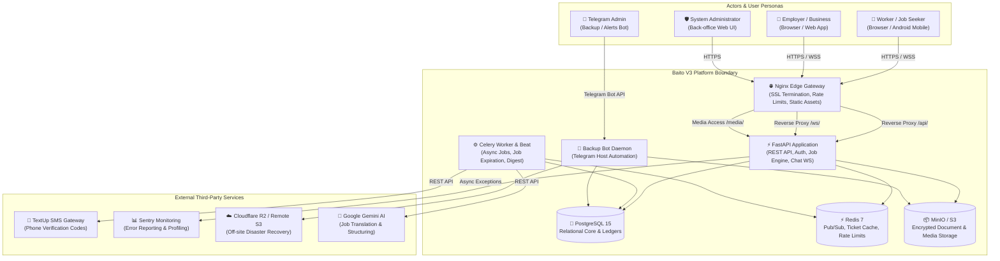
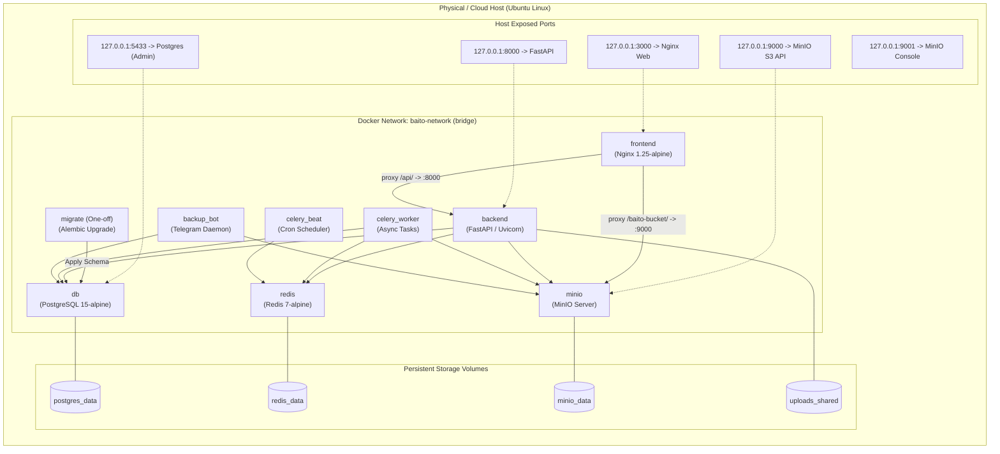
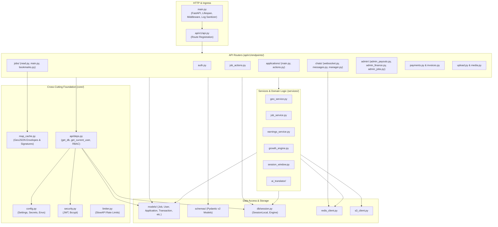
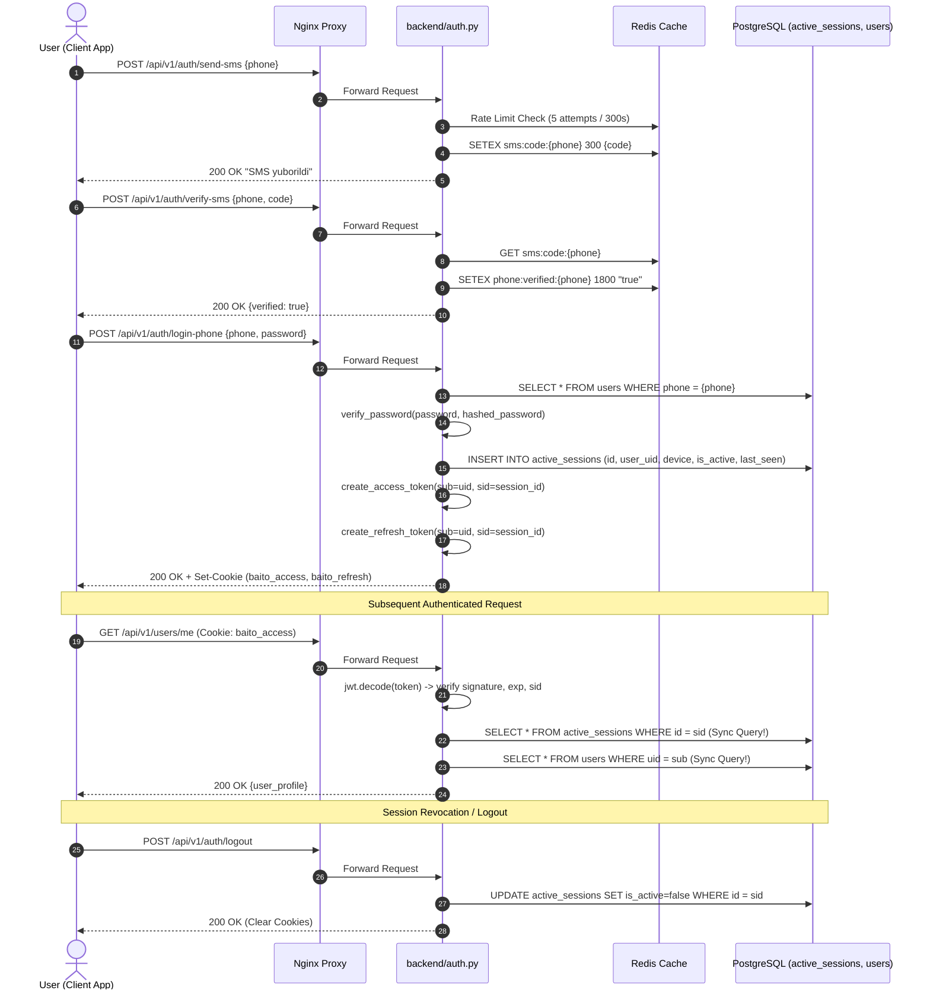
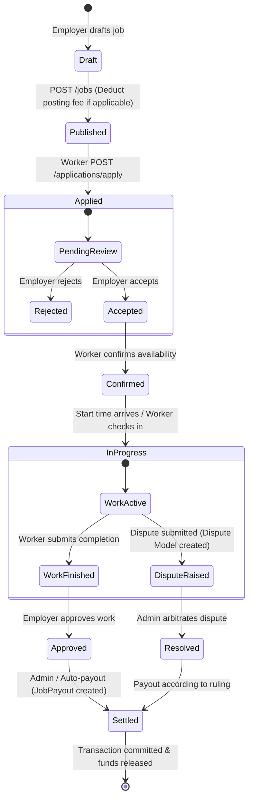
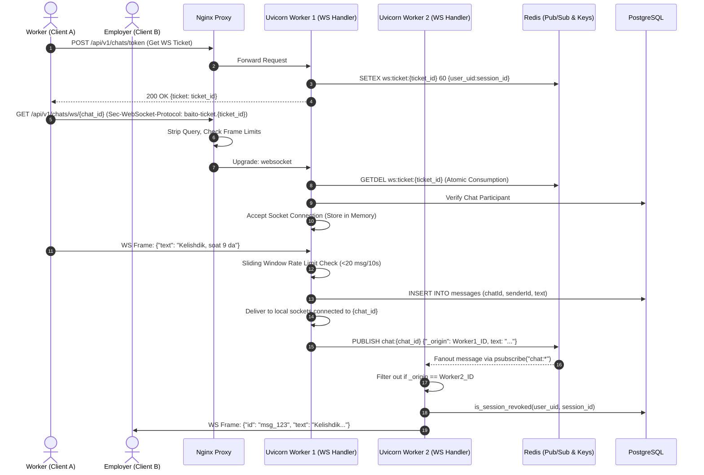
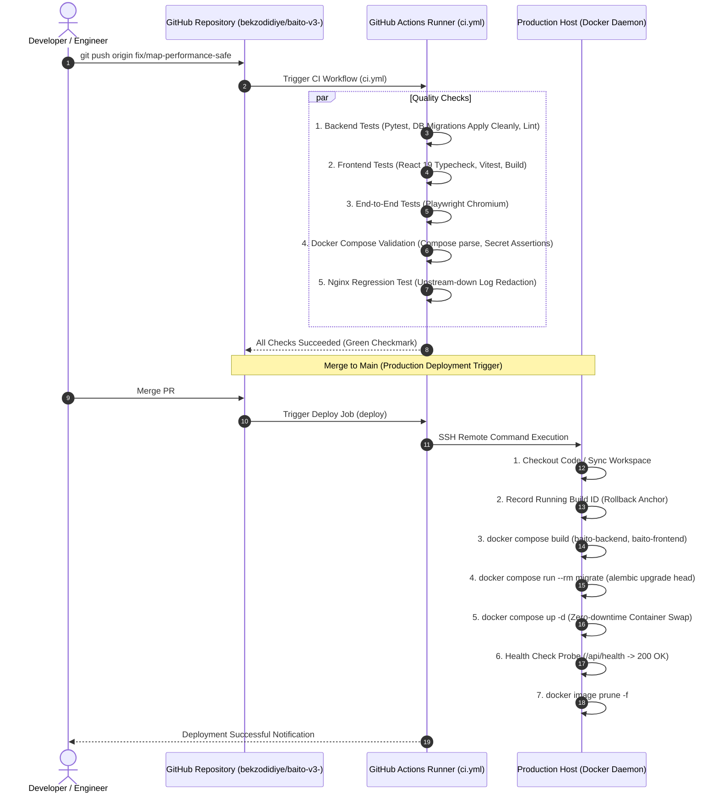

# Baito V3 — System Design & High-Level Architecture

**Document:** `02_SYSTEM_ARCHITECTURE.md`  
**Scope:** Architecture reconstruction, communication topologies, 8 Mermaid sequence/flow diagrams, boundary analysis, single points of failure, and scalability limits.

---

## 1. Architectural Classification

Baito V3 is structured as a **Containerized Modular Monolith** with an asynchronous backend, decoupled Single Page Application (SPA) web frontend, hybrid mobile client, and distributed background workers.

```
[Clients]
Web SPA (React 19) / Mobile (Capacitor)
       │
       ▼
[Edge / Ingress]
Nginx Reverse Proxy (:80 / :443)
       │
       ├─────────────────────────┬──────────────────────┐
       ▼                         ▼                      ▼
Static Assets / SPA       FastAPI Backend        MinIO Media
(Local / Nginx Cache)     (:8000 / Uvicorn)      (:9000 / S3 API)
                                 │
           ┌─────────────────────┼──────────────────────┐
           ▼                     ▼                      ▼
    PostgreSQL 15          Redis 7 (Standalone)    Celery Workers & Beat
    (Relational OLTP)     (Cache, Pub/Sub, Queues) (Scheduled / Async Tasks)
```

### Monolith vs. Distributed Trade-off Evaluation
- **Current Choice:** A unified modular monolith sharing a single relational database (`baito`) and Redis broker.
- **Verdict: CORRECT ARCHITECTURAL CHOICE.**
  A microservice architecture would introduce severe operational overhead, distributed transaction failures, network latency, and data consistency headaches for an on-demand marketplace of this scale. The modular monolith pattern allows atomic transactions across jobs, applications, payments, and audit ledgers while maintaining high engineering velocity.
- **Deficiencies:** The backend suffers from leaky boundaries where HTTP controllers (`jobs/read.py`, `admin_payouts.py`) directly invoke complex SQL and spatial calculations rather than isolating logic inside domain services.

---

## 2. Comprehensive System Architecture Diagrams

### Diagram 1: System Context Diagram
Shows external actors, systems, and platform boundaries.



---

### Diagram 2: Container & Service Architecture
Illustrates Docker Compose runtime boundaries, network topologies, and volume mounts.



---

### Diagram 3: Backend Module Dependencies
Maps coupling and import hierarchies inside `backend/app/`.



---

### Diagram 4: Authentication & Session Lifecycle
Sequence showing SMS login, JWT token generation, active session tracking, and revocation.



---

### Diagram 5: Job Listing → Application → Completion & Payout Lifecycle
Visualizes the primary business state machine and financial escrow logic.



---

### Diagram 6: Chat / WebSocket Message Flow (Multi-Worker Pub/Sub)
Shows real-time connection establishment, ticket validation, and cross-worker broadcast via Redis.



---

### Diagram 7: PostgreSQL, Redis & Background Worker Interactions
Depicts data persistence, caching invalidations, and Celery scheduled processing.

```mermaid
flowchart TD
    subgraph FastAPI ["FastAPI Application"]
        JobWrite["Job Create / Update\n(jobs/main.py)"]
        JobRead["Job Map / Viewport Read\n(jobs/read.py)"]
        AuthDep["Auth Dependency\n(deps.py)"]
    end

    subgraph RedisStore ["Redis Data Structures"]
        MapVer["map:version (Global Counter)"]
        UserMapVer["map:version:{user_id}"]
        MapCacheKeys["map:v4:z{z}:bb:{bbox} (GeoJSON Cache)"]
        CeleryQueue["Queue: celery (Task Broker)"]
    end

    subgraph CeleryTasks ["Celery Background Tasks"]
        ExpireJobs["app.tasks.expire_stale_jobs\n(Runs 03:00 Daily)"]
        PurgeIdemp["app.tasks.purge_expired_idempotency_keys\n(Runs 04:00 Daily)"]
        TelegramDigest["app.tasks.send_telegram_digest\n(Runs 09:00 Daily)"]
        AsyncTranslate["app.tasks.translate_job_task\n(Triggered on Job Create)"]
    end

    subgraph DBStore ["PostgreSQL Database"]
        tJobs[(jobs)]
        tApp[(applications)]
        tLedger[(audit_ledgers)]
        tIdemp[(idempotency_keys)]
    end

    JobWrite -->|1. Write Transaction| tJobs
    JobWrite -->|2. INCR map:version| MapVer
    JobWrite -->|3. Enqueue Translate| CeleryQueue

    JobRead -->|1. Check Version & Cache| MapCacheKeys
    JobRead -.->|2. Cache Miss: Execute SQL| tJobs
    JobRead -->|3. Store Envelope| MapCacheKeys

    CeleryQueue --> ExpireJobs
    CeleryQueue --> PurgeIdemp
    CeleryQueue --> TelegramDigest
    CeleryQueue --> AsyncTranslate

    ExpireJobs -->|UPDATE jobs SET status='cancelled'| tJobs
    PurgeIdemp -->|DELETE FROM idempotency_keys WHERE created_at < NOW() - 24h| tIdemp
    AsyncTranslate -->|UPDATE jobs SET title_ru=..., desc_ru=...| tJobs
```

---

### Diagram 8: CI/CD & Production Deployment Topology
Traces code commit to production container swap and database migration.



---

## 3. Failure Domain & Single Point of Failure (SPOF) Analysis

| Component | Failure Impact | Current Mitigation | Vulnerability / Residual Risk |
|---|---|---|---|
| **Nginx Ingress** | Total platform outage (HTTP/WS unreachable). | Nginx error pages (`50x.html`), log redaction filters. | **SPOF:** Single Nginx process on a single host. No DNS-level multi-region or keepalived failover. |
| **PostgreSQL 15** | Platform enters read-only or HTTP 503 degraded state. | Automatic reconnect attempts; health probe reports degraded. | **SPOF:** Single primary database instance without streaming replication or automated read-replica failover. |
| **Redis 7** | Real-time chat cross-node fanout stops; WebSocket tickets fail; map cache degraded. | `redis_is_mock()` fallback allows local in-memory fallback during isolated test runs. | In production, Redis failure stops WebSocket upgrades and invalidates rate limiting. |
| **MinIO S3** | Image/document uploads fail; media viewing blocked. | Authentication route falls back gracefully if S3 client errors. | Single MinIO volume on local disk; backup bot synchronizes to Telegram and offsite R2. |
| **Celery Worker** | Background SMS delivery delayed; job auto-expiration halts. | Late ack (`task_acks_late=True`), worker soft time limits (90s). | In-flight tasks lost if container crashes abruptly without Redis persistence. |
