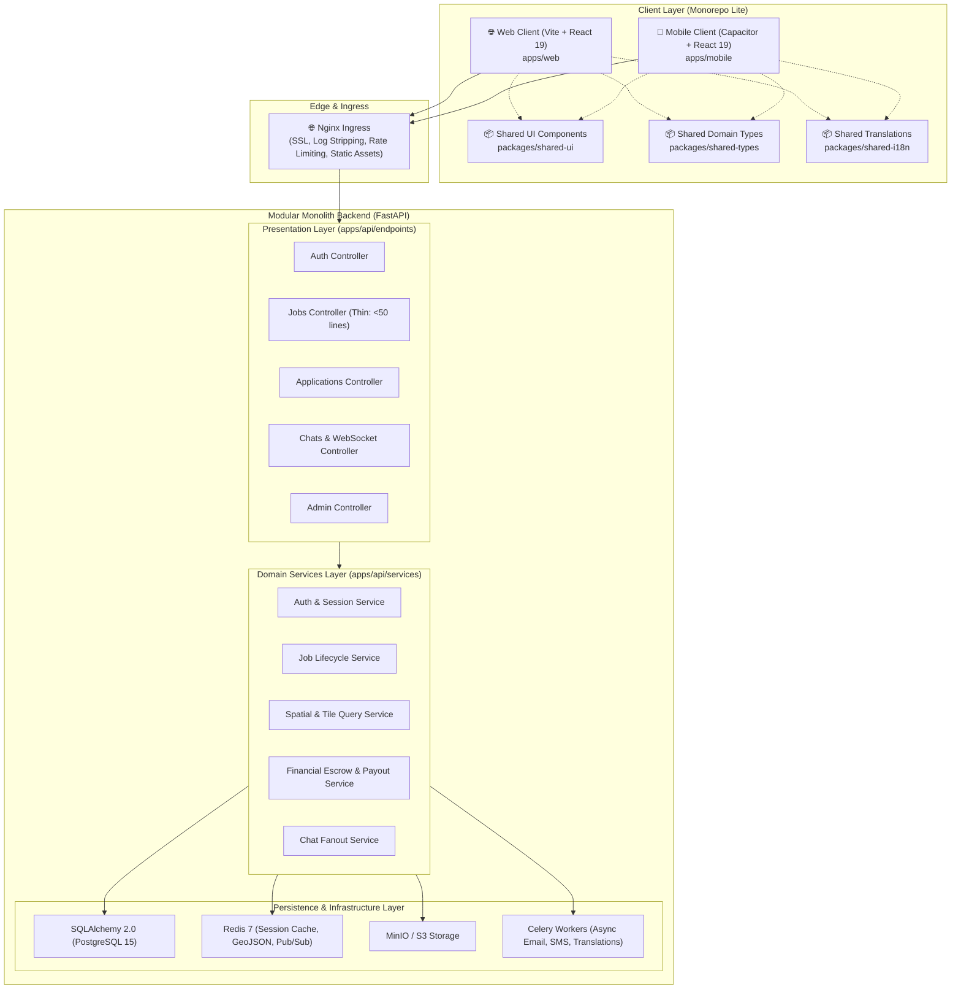

# Baito V3 — Ideal Target Architecture

**Document:** `11_TARGET_ARCHITECTURE.md`  
**Scope:** Pragmatic target system design, Modular Monolith blueprint, shared package architecture, session caching, and phased transition strategy.

---

## 1. Architectural Philosophy: The Well-Structured Modular Monolith

**We explicitly reject a Microservices or Event-Sourcing rewrite for Baito V3.**

A microservices decomposition at this stage would introduce:
- Distributed transaction complexity across jobs, payments, and disputes.
- 5x increase in deployment and observability infrastructure overhead.
- High network latency between services for simple marketplace workflows.
- Slower feature development velocity for a growing engineering team.

Instead, the **Ideal Target Architecture for Baito V3 is a Clean Modular Monolith** with:
1. **Separation of Presentation and Domain Logic:** Thin HTTP routers, fat domain services, and dedicated query objects.
2. **Monorepo Lite for Web and Mobile:** A single workspace sharing TypeScript types, UI components, and localization dictionaries.
3. **Multi-Layered Caching:** Redis session and viewport cache shielding the relational database.
4. **Unified Background Workers:** Standardized Celery task queues for all asynchronous side-effects.

---

## 2. Target System Topology



---

## 3. Target Repository File Structure

```
baito-v3/
├── .github/workflows/
│   ├── backend.yml          # Pytest, DB migrations, Ruff lint
│   ├── web.yml              # Web typecheck, Vitest, Playwright
│   ├── mobile.yml           # Mobile typecheck & Capacitor build
│   └── release.yml          # Zero-downtime production deployment
├── apps/
│   ├── api/                 # FastAPI backend service
│   │   ├── app/
│   │   │   ├── api/v1/      # Thin HTTP controllers
│   │   │   ├── services/    # Pure domain services (Spatial, Payout, Job, Auth)
│   │   │   ├── models/      # SQLAlchemy ORM models
│   │   │   ├── schemas/     # Pydantic v2 validation contracts
│   │   │   └── core/        # Config, Security, Redis, S3
│   │   ├── alembic/         # Linear database migration versions
│   │   ├── tests/           # Integration & unit test suites
│   │   └── Dockerfile
│   ├── web/                 # Web client (Vite + React 19)
│   │   ├── src/             # Pages and feature-specific routing
│   │   ├── nginx.conf       # Ingress reverse proxy configuration
│   │   └── package.json
│   └── mobile/              # Mobile client (Capacitor + React 19)
│       ├── android/         # Android Studio Gradle workspace
│       ├── src/             # Mobile-specific views and shell
│       └── package.json
├── packages/
│   ├── shared-types/        # Shared TypeScript contracts (Job, User, Chat, etc.)
│   ├── shared-ui/           # Reusable Tailwind v4 components (Header, Nav, Modals)
│   └── shared-i18n/         # Centralized language dictionaries (UZ, RU, EN)
├── docker/
│   ├── docker-compose.yml
│   └── docker-compose.prod.yml
├── docs/                    # Architecture, QA, and operational runbooks
├── scripts/                 # Canonical backup, restore, and deployment bash scripts
├── AGENTS.md                # Single consolidated AI instruction handbook
└── package.json             # Root npm workspace definition
```

---

## 4. Phased Architecture Transition Strategy

### 4.1 What Must Be Done NOW (Sprint 1 / Pre-Release)
- **SEC-001 & SEC-002 Remediation:** Purge `cookie.txt` and `local_backup_sync.sh` from the repository and git history.
- **CI Mobile Gate:** Add `mobile/` build and typecheck to `.github/workflows/ci.yml`.
- **Repository Hygiene:** Purge root `.patch`, `.log`, and dangling `.db` files.
- **Dead Code Purge:** Delete `mobile/src/pages/Home.tsx`, `ExploreContainer.tsx`, and empty folders.

### 4.2 What Should Be Done Gradually (Q1 2027)
- **Decompose `jobs/read.py`:** Extract the 900-line spatial map clustering algorithm into `app/services/spatial_query_service.py`.
- **Extract Payout Service:** Move escrow calculations from `admin_payouts.py` to `app/services/payout_service.py`.
- **Implement Session Cache:** Cache session validity in Redis to eliminate the 2x DB hit per HTTP request.
- **Extract Shared Packages:** Configure npm workspaces to share `translations/` and core UI components between `frontend` and `mobile`.

### 4.3 What Is Justified Only at 10x Scale (Late 2027+)
- **PostgreSQL Read Replicas:** When active user count exceeds 100,000 DAU, provision a PostgreSQL streaming read-replica for map queries and reporting.
- **PostGIS Geospatial Engine:** If cross-border polygon geofencing or advanced routing is required, adopt PostGIS.
- **Multi-Node Redis Cluster:** Switch from single-node Redis to Redis Sentinel or Cluster for high availability.

### 4.4 What Should DELIBERATELY NOT Be Done
- **DO NOT rewrite into Microservices:** Keep the application as a single deployable backend.
- **DO NOT adopt GraphQL:** REST with Pydantic schemas and WebSockets provide cleaner contracts, lower overhead, and better caching.
- **DO NOT introduce Event Sourcing:** Standard relational transactions with double-entry `audit_ledgers` provide full auditability without the extreme complexity of CQRS/ES.
