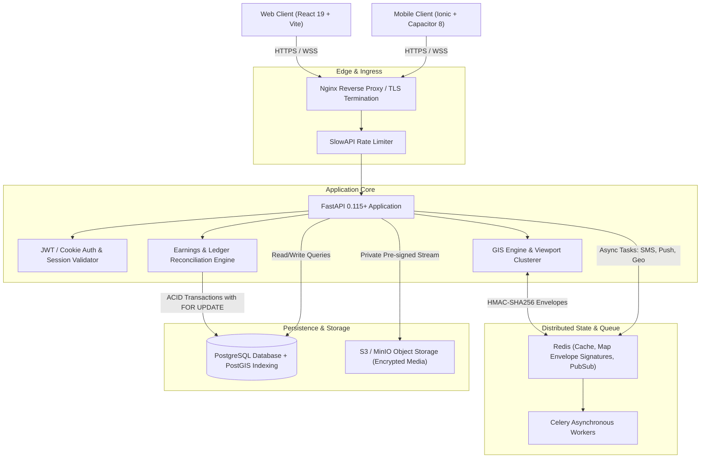

# 02 — ARCHITECTURE MAP: BAITO V3 PLATFORM

---

## 1. System Components & Technologies

### Backend Services
- **Runtime**: Python 3.11.9.
- **Web Framework**: FastAPI with Starlette ASGI.
- **ORM & Data Layer**: SQLAlchemy 2.0 with PostgreSQL driver (`asyncpg` / `psycopg2`).
- **Data Validation & Schemas**: Pydantic v2 with strict type coercion.
- **Database Migrations**: Alembic (23 revisions up to `0023_add_dispute_unique`).
- **Distributed Cache & Broker**: Redis 7.x (HMAC signed map cache, session revocations, rate limiting, Celery broker).
- **Background Job Processor**: Celery 5.x for SMS dispatch, email invoicing, and AI job translation.
- **Media Storage**: S3-compatible object store with restricted signed streaming proxy (`/api/v1/media/{key}`).

### Frontend & Mobile Clients
- **Web Client**: React 19, TypeScript 5.6, Tailwind CSS v4, Motion, Lucide React, Leaflet, TanStack Query v5, Zustand v5.
- **Mobile Client**: Capacitor 8, Ionic React, Tailwind CSS v4, Lucide React, Leaflet.

---

## 2. Trust Boundaries & Security Domains

1. **Public Anonymous Perimeter**:
   - Endpoints: `/auth/login`, `/auth/verify-sms`, `/jobs/map` (public nationwide clusters), `/invoices/{token}` (view & declaration only).
   - Rate limiting enforced on all public paths via SlowAPI (`@limiter.limit`).
2. **Authenticated Worker Perimeter**:
   - Endpoints: `/jobs/apply`, `/payments/cards`, `/payments/withdraw`, `/chats/`, `/reviews`.
   - Verified worker status required for applying to shifts (`isVerified == True`).
   - Phone verification required before account registration.
3. **Authenticated Employer Perimeter**:
   - Endpoints: `/jobs` (creation, edit, cancellation), `/jobs/my`, `/applications/{id}/accept`.
   - Verification required before shift publication.
4. **Administrative Perimeter**:
   - Endpoints: `/admin/users`, `/admin/finance`, `/admin/payouts`, `/admin/disputes`, `/admin/categories`.
   - Protected by `get_admin_user` dependency validating `role == 'admin'`.
5. **Data Storage & Media Access Boundary**:
   - User identity documents (passport front/back, selfie) and payment receipts are completely non-public. They are served strictly through `/media/{object_key}` which performs authorization checks against the database before streaming S3 chunks.

---

## 3. Critical Platform Data Flows

### Shift Completion & Settlement Flow
1. Worker starts shift (`POST /jobs/{id}/start-shift`). System stamps `startedAt` and sets application status to `in_progress`.
2. Job finishes (`POST /jobs/{id}/finish`):
   - Nested transaction locks affected `User` records with `with_for_update()`.
   - Calculates fee via `job_fee_percent(db, job)`.
   - Credits worker balance in UZS (`worker.balance += wage`).
   - Writes `Transaction` row with amount in Tiyin (`amount_uzs * 100`).
   - Appends immutable `AuditLedger` row with `amountDelta` and `balanceAfter`.
   - Creates `JobPayout` record representing corporate invoice obligation.
   - Commits atomically.
3. Employer pays invoice via bank transfer or card declaration (`POST /invoices/{token}/pay`).
4. Administrator verifies bank receipt and confirms payout (`POST /admin/payouts/{id}/confirm`).

### Viewport Geospatial Map Cache Flow
1. Client sends viewport bounding box coordinates (`min_lat`, `max_lat`, `min_lng`, `max_lng`) with optional auth cookie.
2. Server verifies caller identity and computes cache key bound to user ID (for personalized bookmarks/applications) or public hash.
3. Cache Lookup:
   - If Redis hit: Verifies HMAC-SHA-256 envelope signature covering the entire JSON payload, cache key, and caller identity. If valid, returns payload with zero DB queries.
   - If Redis miss: Executes PostgreSQL spatial query bounded by coordinate window and Uzbekistan national boundary polygon. Computes individual pin HMAC signatures and envelope signature, writes to Redis with configured TTL, and streams response.
